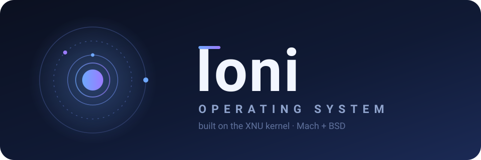

<div align="center">



**Ioni** — независимая операционная система на ядре XNU (Mach + BSD)

[English](README.md) · [Русский](README.ru.md) · [Дорожная карта](ROADMAP.md)


[](https://github.com/mel0k1/ioni-os/actions/workflows/build.yml)

</div>

## Что такое Ioni?

Ioni — экспериментальная операционная система, построенная на **XNU** — гибридном ядре, на котором работают macOS и iOS. XNU объединяет микроядро Mach из Carnegie Mellon с BSD-слоем поверх него. Это одно из самых проверенных временем ядер в индустрии: десятилетия харденинга, зрелая система виртуальной памяти, полноценный POSIX-совместимый BSD-слой и драйверный фреймворк IOKit, доказавший себя на миллиардах устройств.

Идея Ioni проста: взять эту проверенную основу и построить вокруг неё независимую открытую ОС — сохранить инженерное качество Darwin, но снять платформенную привязку к Apple. Вместо того чтобы изобретать ядро с нуля, проект тратит силы на уровни выше: userland, пакетный менеджер и, в перспективе, графический рабочий стол.

Проект уже прошёл **этап фундамента**. База исходников ядра импортирована, поверхностный ребрендинг применён — система представляется как `Ioni` через `uname -s`, `sysctl kern.ostype` и баннер загрузки ядра, — а build-система теперь выдаёт бинарники ядра на CI. Появились и первые куски собственного userland'а Ioni (`init`, шелл). Всё, что глубже (ABI, syscall'ы, драйверы), сознательно держится близко к апстриму: пока собственный userland Ioni растёт, можно опираться на существующую экосистему Darwin, а не бороться с ней.

## Цели

Крупные вехи на пути, между ними — задачи поменьше:

| # | Этап | Статус |
|---|------|--------|
| 1 | Ядро собирается и загружается в ВМ | сборка есть · загрузка — дальше |
| 2 | Минимальный userland: libc, init, shell | начат — init, шелл, rootfs-образ |
| 3 | **Порт Homebrew** — пакетный менеджер на Ioni | цель |
| 4 | **XQuartz + FluxBox** — графический десктоп на X11 | цель |

Полный пошаговый план — в [ROADMAP.md](ROADMAP.md).

## Что внутри

Сейчас в репозитории лежит база исходников XNU:

| Каталог | Что это |
|---------|---------|
| `osfmk/` | Микроядро Mach: планировщик, виртуальная память, IPC |
| `bsd/` | Слой BSD: модель процессов POSIX, VFS, сеть, syscall'ы |
| `iokit/` | Драйверный фреймворк IOKit и драйверы |
| `libkern/` | C++-рантайм ядра и базовые библиотеки |
| `libsyscall/` | Заготовки системных вызовов для userland (libSystem) |
| `pexpert/` | Platform Expert: ранняя загрузка и обнаружение платформы |
| `security/` | Подсистема безопасности ядра (MAC-фреймворк) |
| `libkdd/` `libsa/` `tools/` `tests/` | Отладочные данные ядра, библиотеки, инструменты, тесты |
| `userland/` | Собственные init и шелл Ioni — первые нативные куски |
| `boot/xnu-loader/` | UEFI-загрузчик (BSD-3, вендорен из PureDarwin/xnu-loader): грузит x86_64-ядро на QEMU |
| `boot/kc-tools/` | Открытый сборщик kernel collection (BSD-3, вендорен из PureDarwin/kc-tools) |

## Сборка

XNU собирается только на macOS с установленным Xcode. Скрипты-обёртки прячут детали make:

```sh
./scripts/build.sh                                                  # RELEASE, архитектура машины
KERNEL_CONFIGS=DEVELOPMENT ARCH_CONFIGS=X86_64 ./scripts/build.sh   # свой вариант
```

При первом запуске `build.sh` вызывает `scripts/deps.sh`, который собирает fakeroot с тем, что нужно ядру: экспортированные заголовки ядра, заголовки libplatform и `libfirehose_kernel.a` из libdispatch Apple — всё запиновано на теги соответствующего release-манифеста macOS (26.5: `libdispatch-1542.100.32`, `libplatform-375.120.2`). `mig` и ctf-утилиты собираются только если Xcode их не даёт. Артефакты падают в `BUILD/obj/<CONFIG>_<ARCH>/`: `kernel` — загружаемый образ, `kernel.unstripped` — с символами для отладки; `./scripts/clean.sh` чистит дерево сборки.

CI запускается на каждый пуш в `main` и на pull request'ы на раннерах `macos-26` в GitHub Actions: экспорт заголовков для ARM64 и X86_64 и полная сборка **x86_64-ядра** — жёсткие гейты, бинарник x86_64-ядра выкладывается как артефакт сборки. ARM64-джоба остаётся experimental, пока для её линковки не появятся машинные библиотеки из KDK (sptm/txm).

## Загрузка в QEMU

x86_64-ядро грузится в QEMU через вендоренный UEFI-загрузчик [xnu-loader](https://github.com/PureDarwin/xnu-loader) — без macOS, без kmutil, без nested virtualization: работает на обычном Linux-хосте и на GitHub CI-раннерах:

```sh
sudo apt install qemu-system-x86 ovmf mtools dosfstools
./scripts/gnuefi.sh
cmake -S boot/xnu-loader -B boot/xnu-loader/build -DGNU_EFI_DIR=$HOME/.local/gnu-efi
cmake --build boot/xnu-loader/build -j
./scripts/qemu-boot.sh BUILD/obj/RELEASE_X86_64/kernel
```

`scripts/qemu-boot.sh` собирает FAT ESP-образ (`BOOTX64.EFI` + `kernel`), запускает OVMF + QEMU (q35, TCG) с захватом serial-консоли в `BUILD/qemu-serial.log` и проходит, если ядро выдало serial-вывод. `IONI_BOOT_ARGS` переопределяет дефолтные boot-args загрузчика; логи падают в `BUILD/`. Тот же сценарий крутится в CI на `ubuntu-24.04`-раннере на каждый пуш.

## Userland

Первые куски собственного userland'а Ioni лежат в `userland/`:

- `init` — PID 1: подключает консоль, запускает шелл, собирает сирот и перезапускает шелл после выхода
- `ionish` — небольшой POSIX-шелл: встроенные `cd`, `echo`, `pwd`, `env`, `exit`, внешние команды через fork+exec

Оба собираются сегодня под хостовый SDK — бинарно совместимы с базой XNU — и прогоняют смоук-тесты в CI на каждом ране. `scripts/rootfs.sh` собирает корневую ФС (`/sbin/init`, `/bin/sh`, `/etc/motd`, `/etc/rc`) в HFS+-образ `ioni-rootfs.dmg`, который тоже выкладывается артефактом CI. Вырастить это в собственную libc (Libsystem) и dyld — следующая веха userland'а.

## Лицензия

XNU распространяется по лицензии **Apple Public Source License 2.0** (APSL-2.0) — полный текст лежит в файле [APPLE_LICENSE](APPLE_LICENSE). Ioni наследует эту лицензию для всего, что производно от XNU; оригинальная документация Ioni в репозитории публикуется на тех же условиях — для простоты. Вендоренные загрузочные утилиты (`boot/xnu-loader`, `boot/kc-tools`) сохраняют собственную лицензию **BSD 3-Clause** и копирайт апстрима — см. файл `LICENSE` в каждом каталоге.
